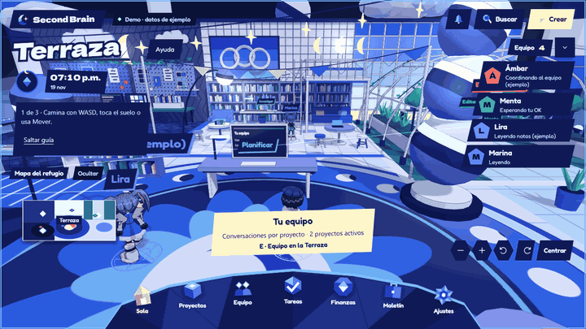

# SecondBrain

[English](README.md)

**Un espacio de trabajo personal autohospedado donde tú y un equipo de agentes
de IA comparten una misma base de conocimiento.** Proyectos, tareas, agenda y
finanzas viven como Markdown en un vault versionado con Git; un "refugio" 3D es
la puerta de entrada; y agentes de Claude, Codex, Antigravity y DeepSeek
trabajan en tus repositorios en sesiones aisladas, pidiendo tu aprobación
antes de cualquier acción con consecuencias reales.

**[Probar la demo →](https://paul-jar4millo.github.io/SecondBrain/?lang=es)**
(datos sintéticos, se ejecuta en el navegador)



## Puntos clave

- **Tus notas siguen siendo archivos.** Markdown + YAML. Un único servicio
  escribe; cada escritura se valida por hash, se registra en journal y se
  versiona con Git.
- **Agentes aislados de tus datos.** Los CLIs corren con un usuario Unix
  propio, límites de recursos y un firewall que bloquea la red local. Llegan
  al vault solo mediante herramientas MCP limitadas.
- **Conversaciones estructuradas con cuatro proveedores** mediante
  adaptadores propios (Codex app-server, Claude Agent SDK y ACP).
- **Deshacer lo que hace un agente.** Cada turno guarda un punto de control en
  refs privadas de Git: diff, revertir o abrir un pull request.
- **Tú decides.** Las operaciones financieras y efectos externos esperan una
  aprobación explícita e idempotente; los equipos respetan un manifiesto
  aprobado.
- **PWA offline-first**, accesible sin WebGL, en español e inglés.
- **Entrega segura.** Despliegue solo desde tags de versión, con aprobación
  manual, health check y rollback automático.

## Empezar

Requiere Node.js 24 y npm.

```sh
npm run setup
git config core.hooksPath .githooks
npm run dev            # http://127.0.0.1:5173/?demo=1
```

Instalación completa con agentes: [deployment](docs/deployment.md).

## Documentación

La documentación técnica está en inglés: [arquitectura](docs/architecture/README.md),
[decisiones](docs/adr/README.md), [módulos](docs/modules/), [API](docs/api.md),
[herramientas MCP](docs/mcp-tools.md), [configuración](docs/configuration.md),
[despliegue](docs/deployment.md), [operación](docs/operations.md) y
[CI/CD](docs/ci-cd.md). La interfaz está en español por defecto.

## Licencia

[MIT](LICENSE) © 2026 Paúl Jaramillo.
