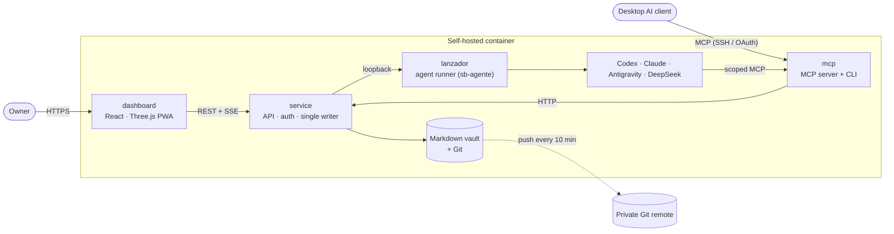

# SecondBrain

**English** · [Español](README.es.md)

[](https://github.com/paul-jar4millo/SecondBrain/actions/workflows/ci.yml)
[](https://paul-jar4millo.github.io/SecondBrain/?lang=en)
[](LICENSE)


**A self-hosted personal workspace where you and a team of AI agents share one
knowledge base.** Projects, tasks, calendar and finances live as plain
Markdown in a Git-versioned vault; a 3D "refuge" is the front door; and
Claude, Codex, Antigravity and DeepSeek agents work on your repositories in
isolated sessions, asking for your approval before anything with real-world
consequences.

**[Try the live demo →](https://paul-jar4millo.github.io/SecondBrain/?lang=en)**
(synthetic data, runs entirely in your browser)


## Highlights

- **Your notes stay plain files.** Markdown + YAML, readable in any editor.
  One service is the only writer; every write is hash-checked, journaled and
  committed to Git, so concurrent clients never overwrite each other.
- **Agents in a sandbox, not in your data.** Agent CLIs run as a separate Unix
  user with resource limits and a firewall that blocks the local network.
  They reach the vault only through scoped MCP tools.
- **Structured conversations with four providers.** Own adapters for Codex
  app-server, the Claude Agent SDK and the Agent Client Protocol turn
  questions and permission prompts into answerable cards.
- **Undo for agents.** Every turn is checkpointed in private Git refs; you can
  diff, revert, or turn a session's work into a pull request.
- **Human in the loop.** Finance operations and external effects wait for an
  explicit, idempotent approval. Agent teams are bounded by a manifest you
  approve.
- **Offline-first PWA.** IndexedDB cache and an outbox of mutations; works
  without WebGL; Spanish and English.
- **Boring, safe delivery.** Releases deploy from version tags only, after a
  manual approval, through a self-hosted runner that never runs pull-request
  code, with health checks and automatic rollback.

## Architecture



More in [architecture](docs/architecture/README.md) (C4 diagrams and request
flows) and the [decision records](docs/adr/README.md).

## Quick start

Requires Node.js 24 and npm.

```sh
git clone https://github.com/paul-jar4millo/SecondBrain.git && cd SecondBrain
npm run setup
git config core.hooksPath .githooks
npm run dev            # http://127.0.0.1:5173/?demo=1
```

To run against a real (throw-away) vault:

```sh
mkdir -p /tmp/sb-vault && echo "# Home" > /tmp/sb-vault/Home.md
VAULT_ROOT=/tmp/sb-vault DATA_DIR=/tmp/sb-data npm run dev
```

Or with Docker: `cd dashboard && VAULT_ROOT=~/sb-vault docker compose up -d --build`.
The full install with agents is in [deployment](docs/deployment.md).

## Quality

| Check           | Tooling                                                                                              |
| --------------- | ---------------------------------------------------------------------------------------------------- |
| Tests           | ~540 tests: `node:test` for service, MCP, runner and ops; Vitest + Testing Library for the dashboard |
| Coverage        | V8 coverage per module, summarized in every CI run (service ≈ 85 % lines)                            |
| Browser         | Playwright suites for the refuge, tools, approvals and conversations, desktop and mobile             |
| Static analysis | ESLint, Prettier, TypeScript (`strict` in the dashboard, `@ts-check` in Node modules), ShellCheck    |
| Supply chain    | Exact dependency versions, SHA-pinned actions, Dependabot, `npm audit`                               |
| History         | Conventional Commits, checked by a hook and in CI                                                    |

```sh
npm test && npm run test:api        # unit and integration
npm run lint && npm run typecheck   # static analysis
npm run coverage                    # per-module coverage table
```

## Documentation

|                                                                     |                                                                                                                                              |
| ------------------------------------------------------------------- | -------------------------------------------------------------------------------------------------------------------------------------------- |
| [Architecture](docs/architecture/README.md)                         | Context, containers, request flows                                                                                                           |
| [Modules](docs/modules/)                                            | [service](docs/modules/service.md), [mcp](docs/modules/mcp.md), [lanzador](docs/modules/launcher.md), [dashboard](docs/modules/dashboard.md) |
| [HTTP API](docs/api.md) · [MCP tools](docs/mcp-tools.md)            | Interfaces                                                                                                                                   |
| [Configuration](docs/configuration.md)                              | Environment variables and host files                                                                                                         |
| [Deployment](docs/deployment.md) · [Operations](docs/operations.md) | Docker, Proxmox VE, backups, rollback                                                                                                        |
| [CI/CD](docs/ci-cd.md)                                              | Pipelines and releases                                                                                                                       |
| [Product](PRODUCT.md) · [Design](DESIGN.md)                         | What it is for and how it looks                                                                                                              |

## Roadmap

- Finish moving tool content to the i18n dictionaries.
- Split `service/index.mjs` and `launcher/executor.mjs` into route and
  lifecycle modules (the provider controllers are already split).
- Extend `@ts-check` to the remaining Node files.
- Raise MCP and dashboard coverage.

## Contributing and security

Contributions are welcome — see [CONTRIBUTING](CONTRIBUTING.md) and the
[code of conduct](CODE_OF_CONDUCT.md). Report vulnerabilities privately as
described in [SECURITY](SECURITY.md).

## License

[MIT](LICENSE) © 2026 Paúl Jaramillo. Fonts in `dashboard/public/fonts` keep
their OFL licenses; see `dashboard/public/art/PROVENANCE.md` for artwork.
