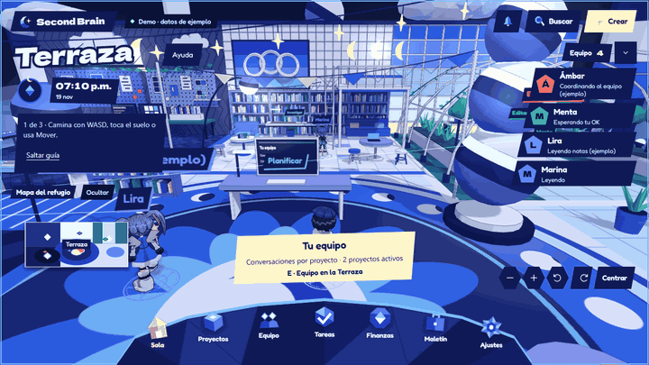
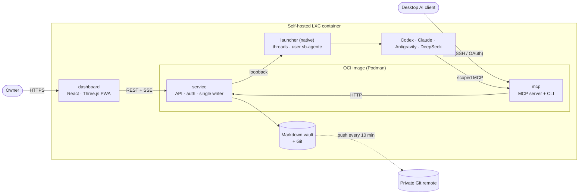

# SecondBrain

**English** · [Español](README.es.md)

[](https://github.com/paul-jar4millo/SecondBrain/actions/workflows/ci.yml)
[](https://paul-jar4millo.github.io/SecondBrain/?lang=en)
[](LICENSE)


**A self-hosted personal workspace where you and a team of AI agents share one
knowledge base.** Projects, tasks, calendar and finances live as plain
Markdown in a Git-versioned vault; a 3D "refuge" is the front door; and
Claude, Codex, Antigravity and DeepSeek agents work on your repositories in
isolated threads, asking for your approval before anything with real-world
consequences.

**[Try the live demo →](https://paul-jar4millo.github.io/SecondBrain/?lang=en)**
(synthetic data, runs entirely in your browser)



## Why

Personal knowledge tools often keep notes in a format only they can read, and
AI agents are usually given either none of your context or far too much
access. SecondBrain takes a different position:

- **Your data stays plain files on hardware you own.** The vault is Markdown
  with YAML front matter in its own private Git repository, readable in any
  editor or in Obsidian, and the whole system runs on one self-hosted
  container.
- **Agents get context, not your disk.** They read and write the vault only
  through a scoped API, run as a separate Unix user with resource limits and a
  firewall, and every action with external effects waits for you.
- **Agent work is reviewable like a colleague's.** Each task is a thread with
  its own Git worktree and branch; you steer it, read the diff and close it by
  pull request, local merge or discard.

## Highlights

- **Single writer, no lost edits.** One service writes the vault. Every write
  carries the hash of the version it was based on, is journaled before the
  file is replaced, and is committed to Git.
- **Threads for agent work.** An append-only SQLite event log with resumable
  streams; steering mid-turn; flows such as Plan → Implement → Review with
  autonomous hand-off, read-only cross review (three rounds at most) and
  subtasks that need your approval.
- **Own provider adapters.** Codex app-server, the Claude Agent SDK and the
  Agent Client Protocol are normalized into one item model, so questions and
  permission prompts become answerable cards instead of scraped terminal
  output.
- **Human in the loop.** Finance operations and external effects wait for an
  explicit, idempotent approval; agent credentials are bound to one thread and
  revoked when it closes.
- **Offline-first PWA.** IndexedDB cache and an outbox of mutations; works
  without WebGL; Spanish and English.
- **Boring, safe delivery.** Releases deploy from version tags only, after a
  manual approval, through a self-hosted runner that never runs pull-request
  code; the release verifies itself and rolls back automatically.

## Architecture



| Module      | Role                                                                                        |
| ----------- | ------------------------------------------------------------------------------------------- |
| `service`   | HTTP API, authentication, the only writer of the vault, finance, approvals, thread proxy    |
| `mcp`       | MCP server and `brain` CLI; an adapter over the HTTP API that never touches files           |
| `launcher`  | Runs agent CLIs for threads in isolation: worktrees, event log, flows, reviews, close by PR |
| `dashboard` | Installable PWA with the 3D refuge and the tools (projects, tasks, finance, threads…)       |
| `contracts` | Zod schemas shared by all modules, in native TypeScript                                     |
| `ops`       | Packaging, provisioning, systemd units, CLI pins, backups, deploy helper                    |

More in [architecture](docs/architecture/README.md) (C4 diagrams and data
ownership), [request flows](docs/architecture/sequences.md) and the
[documentation index](docs/README.md).

## Key decisions

Each choice has a decision record with the options considered and the
trade-offs ([all ADRs](docs/adr/README.md)).

| Decision                                                                                                  | In short                                                                                    |
| --------------------------------------------------------------------------------------------------------- | ------------------------------------------------------------------------------------------- |
| [Single writer over a Git-backed Markdown vault](docs/adr/0001-git-backed-vault-with-single-writer.md)    | Plain files stay the truth; hash checks stop concurrent clients from overwriting each other |
| [No SQL mirror](docs/adr/0002-no-sql-mirror.md)                                                           | In-memory indexes rebuilt from Markdown; nothing to drift or migrate                        |
| [Vault in its own private repository](docs/adr/0012-vault-in-its-own-repository.md)                       | Public code can never publish a note; CI/CD ships code only                                 |
| [MCP as an adapter over the API](docs/adr/0013-mcp-as-an-api-adapter.md)                                  | One place for permissions, journal and approvals, for every client                          |
| [Isolated agent runner](docs/adr/0003-isolated-agent-sessions.md)                                         | Separate Unix user, systemd limits, nftables; the HTTP service never runs a model           |
| [Threads with an SQLite event log](docs/adr/0010-threads-replace-sessions.md)                             | One task per thread with its own worktree; resumable streams; auditable hand-offs           |
| [Native TypeScript and shared Zod contracts](docs/adr/0011-native-typescript-and-contracts.md)            | One schema for every module and no build step for the backend                               |
| [Service image, native launcher on a self-hosted LXC](docs/adr/0014-container-service-native-launcher.md) | Rollback by image digest; the launcher keeps the host features that isolation needs         |
| [Tag-gated deployment](docs/adr/0015-tag-gated-deployment.md)                                             | Merging never ships; forks never reach the runner; no inbound ports                         |
| [Pinned, contract-tested agent CLIs](docs/adr/0016-pinned-agent-clis.md)                                  | A CLI update is tested in CI before it reaches the host                                     |

## Stack

| Area     | Technology                                                                                       |
| -------- | ------------------------------------------------------------------------------------------------ |
| Backend  | Node.js 24 (`node:http`, no framework), ES modules with JSDoc and native TypeScript, Zod 4       |
| Storage  | Markdown + YAML with isomorphic-git; `node:sqlite` (WAL) for agent state; JSON-lines journal     |
| Agents   | Claude Agent SDK, Codex app-server (JSON-RPC), Agent Client Protocol, Model Context Protocol SDK |
| Frontend | React 19, Vite, Three.js, Dexie (IndexedDB), PWA with a service worker                           |
| Security | scrypt, TOTP, CSRF, OAuth 2.1 with PKCE, per-thread capability tokens, nftables, systemd limits  |
| Hosting  | Proxmox VE LXC, Podman + Quadlet, systemd timers, restic backups                                 |
| CI/CD    | GitHub Actions (SHA-pinned), GHCR, SBOM, self-hosted outbound runner, Dependabot                 |
| Quality  | `node:test`, Vitest, Testing Library, Playwright, ESLint, Prettier, TypeScript, ShellCheck       |

## Quick start

Requires Node.js 24 and npm.

```sh
git clone https://github.com/paul-jar4millo/SecondBrain.git && cd SecondBrain
npm run setup
git config core.hooksPath .githooks
npm run dev            # http://127.0.0.1:5173/?demo=1
```

To run against a real (throw-away) vault:

```sh
mkdir -p /tmp/sb-vault && echo "# Home" > /tmp/sb-vault/Home.md
VAULT_ROOT=/tmp/sb-vault DATA_DIR=/tmp/sb-data npm run dev
```

Or with Docker: `cd dashboard && VAULT_ROOT=~/sb-vault docker compose up -d --build`.
The full install with agents is in [deployment](docs/deployment.md).

## Quality

| Check           | Tooling                                                                                                   |
| --------------- | --------------------------------------------------------------------------------------------------------- |
| Tests           | `node:test` for service, MCP, launcher, contracts and ops; Vitest + Testing Library for the dashboard     |
| Coverage        | V8 coverage per module, with floors that only go up ([CI/CD](docs/ci-cd.md#coverage-floors))              |
| Browser         | Playwright suites for the refuge, tools, approvals and threads, desktop and mobile                        |
| Agent CLIs      | The real pinned CLIs start in CI, without an account, to check the launcher's arguments                   |
| Static analysis | ESLint, Prettier, TypeScript (`strict` in the dashboard, checked JSDoc and native TS in Node), ShellCheck |
| Supply chain    | Exact dependency versions, SHA-pinned actions, Dependabot, `npm audit`, image SBOM                        |
| History         | Conventional Commits, checked by a hook and in CI; `main` protected by a ruleset                          |

```sh
npm test && npm run test:api        # unit and integration
npm run lint && npm run typecheck   # static analysis
npm run coverage                    # per-module coverage table
```

## Status

In daily use by its author on a home server. v0.7.0 completes multi-agent
threads (flows, hand-off, review, subtasks, usage). It is a single-owner
system: there is no multi-user support or high availability, by design.

## Roadmap

Next are notifications (web push and a Discord bot) and a daily summary; see
the [roadmap](docs/roadmap.md) and the
[milestones](https://github.com/paul-jar4millo/SecondBrain/milestones).

## How it is built

The author designs the system, writes the decision records and reviews every
change. AI coding agents implement much of the code through pull requests,
including from SecondBrain's own threads. Every change, human or agent,
passes the same checks and the same review before it reaches `main`.

## Contributing and security

Contributions are welcome; see [CONTRIBUTING](CONTRIBUTING.md) and the
[code of conduct](CODE_OF_CONDUCT.md). Report vulnerabilities privately as
described in [SECURITY](SECURITY.md).

## License

[MIT](LICENSE) © 2026 Paúl Jaramillo. Fonts in `dashboard/public/fonts` keep
their OFL licenses; see `dashboard/public/art/PROVENANCE.md` for artwork.
