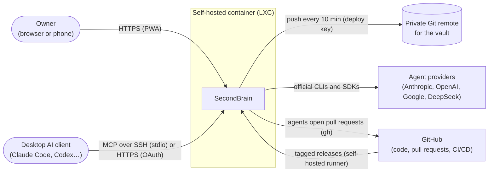
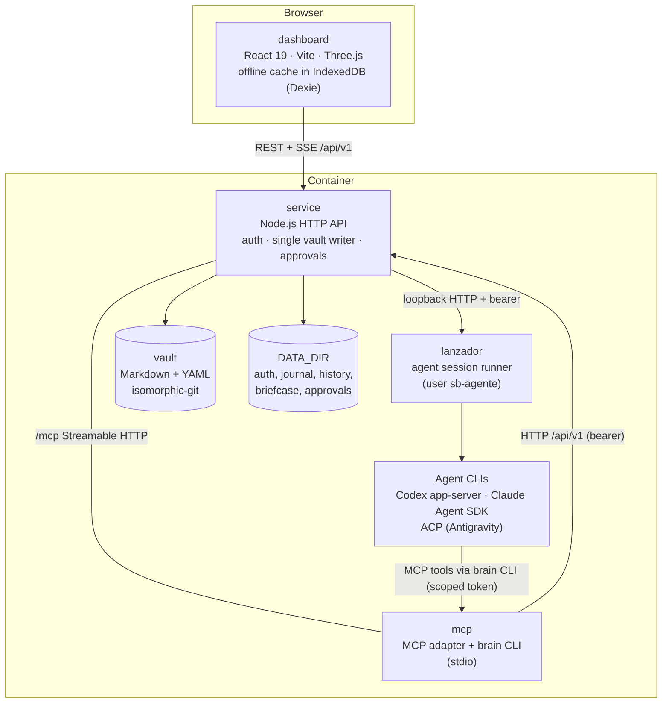

# Architecture

SecondBrain is a self-hosted monorepo with four runtime modules and one
operations module. This page follows the [C4 model](https://c4model.com/):
system context first, then containers. Request flows are in
[sequences](sequences.md); the reasoning behind each choice is in the
[architecture decision records](../adr/README.md).

## System context

The owner works in a 3D "refuge" UI. Their knowledge is a folder of Markdown
notes (the **vault**) versioned in its own private Git repository. AI agents
run as isolated command-line sessions on the same host and reach the vault
only through the service's API.

## Containers

| Container | Responsibility | Code |
| --- | --- | --- |
| `dashboard` | Installable PWA: 3D refuge, tools (projects, tasks, finance, briefcase, team), demo mode, offline outbox | [module guide](../modules/dashboard.md) |
| `service` | The only writer of the vault. Authentication (password, TOTP, OAuth for remote MCP), hash-checked writes, journal and history, finance ledger, approvals, work orders, user requests and effects | [module guide](../modules/service.md) |
| `mcp` | MCP server exposing the vault, finance, briefcase and team tools to agents; a `brain` CLI for isolated sessions | [module guide](../modules/mcp.md) |
| `lanzador` | Starts, observes and cancels agent CLIs in isolated sessions; structured conversations, checkpoints, diffs, pull requests and teams | [module guide](../modules/lanzador.md) |
| `ops` | Release packaging, container provisioning, systemd units, encrypted backups, deployment helper | [deployment](../deployment.md) |

## Key properties

- **Single writer.** Only `service` writes the vault. Every write carries the
  SHA-256 of the version it was based on, so concurrent edits are detected
  instead of overwritten ([ADR 0001](../adr/0001-git-backed-vault-with-single-writer.md)).
- **No database mirror.** Markdown is the source of truth; indexes are rebuilt
  in memory ([ADR 0002](../adr/0002-no-sql-mirror.md)).
- **Isolation.** Agents run as a separate Unix user with their own credentials,
  resource limits and an nftables policy that blocks the local network
  ([ADR 0003](../adr/0003-isolated-agent-sessions.md)).
- **Provider adapters.** One controller per protocol keeps the UI independent
  of each CLI ([ADR 0004](../adr/0004-provider-adapters.md)).
- **Human in the loop.** Agent actions with external effects (finance
  operations, messages) wait for the owner's approval; team work is bounded by
  an approved manifest ([ADR 0005](../adr/0005-team-manifests.md)).

## Data ownership

| Data | Location (production) | Versioned |
| --- | --- | --- |
| Notes and attachments | `VAULT_ROOT` (e.g. `/srv/secondbrain/vault`) | Own private Git repository |
| Auth state, journal, history, briefcase, approvals | `DATA_DIR` (e.g. `/var/lib/secondbrain`) | Encrypted off-host backups (restic) |
| Agent sessions, conversations, provider logins | `/var/lib/sb-agente` | Backups |
| Application code | `/opt/secondbrain/releases/<sha>` + `current` symlink | Git tags |

The application repository never contains notes, credentials or operational
state, and CI/CD only ships code.
