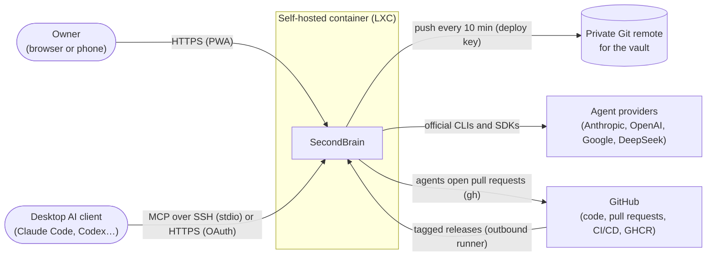
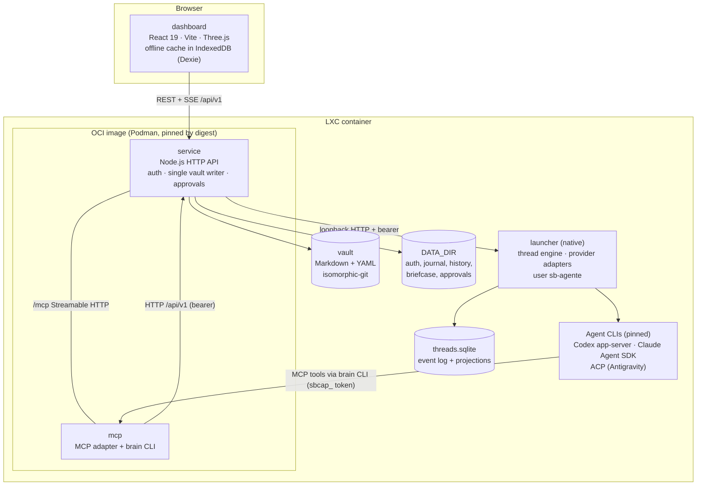

# Architecture

SecondBrain is a self-hosted monorepo with four runtime modules, a shared
`contracts` module and an operations module. This page follows the
[C4 model](https://c4model.com/): system context first, then containers.
Request flows are in [sequences](sequences.md); the reasoning behind each
choice is in the [architecture decision records](../adr/README.md).

## System context

The owner works in a 3D "refuge" UI. Their knowledge is a folder of Markdown
notes (the **vault**) versioned in its own private Git repository
([ADR 0012](../adr/0012-vault-in-its-own-repository.md)). AI agents work on
**threads**: one task each, in its own Git worktree, run by official CLIs as
a separate Unix user on the same host. They reach the vault only through the
service's API.

## Containers

| Container   | Responsibility                                                                                                                                                                                                   | Code                                                       |
| ----------- | ---------------------------------------------------------------------------------------------------------------------------------------------------------------------------------------------------------------- | ---------------------------------------------------------- |
| `dashboard` | Installable PWA: 3D refuge, tools (projects, tasks, finance, briefcase, threads), demo mode, offline outbox                                                                                                      | [module guide](../modules/dashboard.md)                    |
| `service`   | The only writer of the vault. Authentication (password, TOTP, OAuth for remote MCP, per-thread capabilities), hash-checked writes, journal and history, finance, approvals, questions to the owner, thread proxy | [module guide](../modules/service.md)                      |
| `mcp`       | MCP server exposing the vault, finance, briefcase and thread tools; a `brain` CLI for agents inside threads                                                                                                      | [module guide](../modules/mcp.md)                          |
| `launcher`  | Runs agent CLIs for threads: worktrees, structured provider events, steering, flows, hand-offs, reviews, subtasks, diffs, close by PR or merge                                                                   | [module guide](../modules/launcher.md)                     |
| `contracts` | Zod 4 schemas shared by every module (threads, items, events, commands, flows, usage)                                                                                                                            | [ADR 0011](../adr/0011-native-typescript-and-contracts.md) |
| `ops`       | Release packaging, container provisioning, systemd units, CLI pins, host migration, encrypted backups, deployment helper                                                                                         | [deployment](../deployment.md)                             |

## Key properties

- **Single writer.** Only `service` writes the vault. Every write carries the
  SHA-256 of the version it was based on, so concurrent edits are detected
  instead of overwritten ([ADR 0001](../adr/0001-git-backed-vault-with-single-writer.md)).
- **No database mirror of the vault.** Markdown is the source of truth;
  indexes are rebuilt in memory ([ADR 0002](../adr/0002-no-sql-mirror.md)).
  Agent operational state is separate and lives in SQLite
  ([ADR 0009](../adr/0009-operational-state-in-sqlite.md)).
- **One API for every client.** The dashboard, the MCP server and the agents
  all go through `/api/v1` ([ADR 0013](../adr/0013-mcp-as-an-api-adapter.md)).
- **Isolation.** Agents run as a separate Unix user with their own
  credentials, per-thread resource limits and an nftables policy that blocks
  the local network ([ADR 0003](../adr/0003-isolated-agent-sessions.md)).
- **Provider adapters.** One controller per protocol keeps the UI independent
  of each CLI ([ADR 0004](../adr/0004-provider-adapters.md),
  [ADR 0010](../adr/0010-threads-replace-sessions.md)).
- **Human in the loop.** Finance operations and external effects wait for the
  owner's approval; subtasks need approval; reviews stop after three rounds
  and wait for a decision.
- **Safe delivery.** Tag-gated deploys with manual approval, a self-verifying
  release and automatic rollback ([ADR 0014](../adr/0014-container-service-native-launcher.md),
  [ADR 0015](../adr/0015-tag-gated-deployment.md)).

## Data ownership

| Data                                               | Location (production)                                               | Versioned                           |
| -------------------------------------------------- | ------------------------------------------------------------------- | ----------------------------------- |
| Notes and attachments                              | `VAULT_ROOT` (e.g. `/srv/secondbrain/vault`)                        | Own private Git repository          |
| Auth state, journal, history, briefcase, approvals | `DATA_DIR` (e.g. `/var/lib/secondbrain`)                            | Encrypted off-host backups (restic) |
| Threads (event log, items, requests)               | `/var/lib/sb-agent/state/launcher/threads.sqlite`                   | Nightly `VACUUM INTO` + backups     |
| Agent repositories and worktrees                   | `/srv/sb-agent/projects`                                            | Their own Git remotes               |
| Provider CLI logins                                | Home of `sb-agente`                                                 | Not copied; reconnected by hand     |
| Application code                                   | Image by digest + `/opt/secondbrain/releases/<sha>` (launcher, ops) | Git tags                            |

The application repository never contains notes, credentials or operational
state, and CI/CD only ships code.
