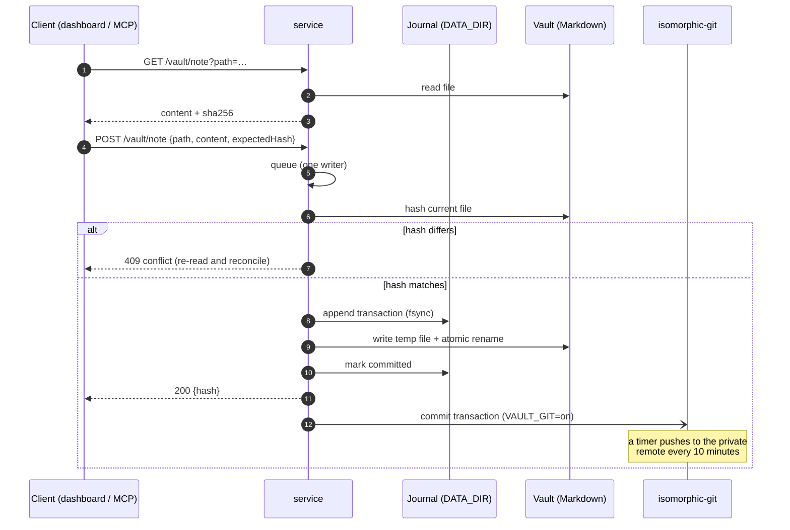
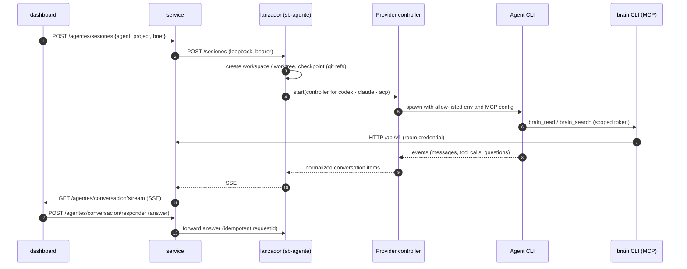

# Request flows

## Writing a note with optimistic concurrency

Every client (dashboard, MCP, CLI) reads the note's revision hash and sends it
back with the full new content. The service serializes writes, journals them
before touching the file and commits confirmed transactions to Git.



If the process stops between steps, the journal is replayed on start-up. A
failing Git commit is logged and never undoes a saved note.

## Running an agent in an isolated session



The HTTP service never runs a model. Each turn ends its process; the next
message resumes the provider's native session id.

## Approving an agent's finance operation

```mermaid
sequenceDiagram
  autonumber
  participant A as Agent (room credential)
  participant S as service
  participant Q as Approvals (DATA_DIR)
  participant D as dashboard (owner)
  participant F as Finance ledger (vault)

  A->>S: POST /finance/ops {op, requestId}
  S->>S: validate; a repeated requestId returns the earlier result
  S->>Q: create pending approval (expires in 30 min)
  Note over A,S: the agent's request stays open<br/>until the owner decides
  S-->>D: change event (SSE)
  D->>S: POST /aprobaciones/decidir {id, approve, requestId}
  S->>Q: store decision + receipt (one JSON line)
  S-->>D: receipt {decision, by, ts}
  alt approved
    S->>F: apply operation (idempotent by requestId)
    S->>Q: finalize ("applied")
    S-->>A: 200 result
  else rejected or expired
    S-->>A: 403 not approved
  end
  Note over D,S: Repeating the same decision requestId returns<br/>the same receipt with repetido: true
```
