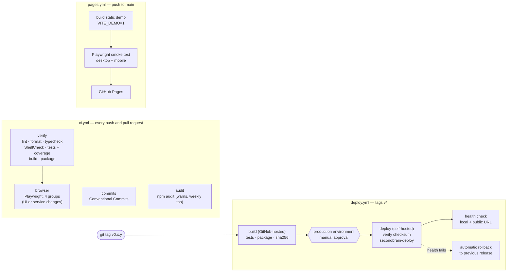

# CI/CD

Three workflows live in `.github/workflows/`. All third-party actions are
pinned to a full commit SHA, workflows default to `contents: read`, and the
self-hosted runner never executes code from pull requests.



## `ci.yml` — verification

| Job              | What it does                                                                                                                                                                                                                                                                | Blocks merge |
| ---------------- | --------------------------------------------------------------------------------------------------------------------------------------------------------------------------------------------------------------------------------------------------------------------------- | ------------ |
| `verify`         | `npm run lint`, `format:check`, `typecheck`; ShellCheck on all shell scripts; `npm run coverage` (node test runner + Vitest with V8 coverage) and the operations tests; builds the dashboard and packages a release; writes a coverage summary to the job page              | Yes          |
| `commits`        | Validates every commit subject with `ops/check-commit.mjs`                                                                                                                                                                                                                  | Yes          |
| `audit`          | `npm audit --omit=dev` per module, leaving a visible warning on high-severity advisories; dev dependencies are informational; also runs weekly                                                                                                                              | No (warns)   |
| `browser`        | Playwright suites in four groups (refuge, approvals, project dashboards, tools, conversations, workspaces) with software WebGL, each retried once; runs for pull requests that touch `dashboard/` or `service/`, for manual runs and weekly; uploads screenshots on failure | No (reports) |
| `browser-report` | On the weekly run only: when a browser suite fails, opens the issue "Weekly browser suites failing" or comments on the open one                                                                                                                                             | No           |

Which checks gate a merge is decided by the branch protection rules; the
recommended set is `verify` and `commits`.

### Coverage floors

`npm run coverage` fails when a module's line coverage drops below its floor
in `ops/coverage.mjs`. Floors only go up: when a change raises coverage,
raise the floor in the same pull request.

| Module    | Baseline (2026-11-19, v0.1.2) | Current | Floor |
| --------- | ----------------------------- | ------- | ----- |
| service   | 85.5%                         | 87.8%   | 87%   |
| launcher  | 65.8%                         | 69.4%   | 68%   |
| dashboard | 40.3%                         | 42.3%   | 42%   |
| mcp       | 38.3%                         | 43.5%   | 41%   |

The dashboard figure only counts `.ts`/`.tsx` files (see
`dashboard/vitest.config.ts`); the remaining `.js` files in
`src/features/room` and `src/features/world` are not measured until they are
converted to TypeScript.

`service/tests/route-smoke.test.mjs` calls every route declared in
`service/routes.mjs` with a valid CSRF token and query, and fails if any of
them is answered before reaching its handler (unknown route, CSRF, invalid
query). It is the safety net for refactoring the HTTP layer.

## `deploy.yml` — continuous deployment

Deployment is **tag-driven**: pushing to `main` never deploys.

1. `build` runs on a GitHub-hosted runner: installs, tests, packages the
   release with `ops/package-release.mjs` and records its SHA-256.
2. `deploy` waits for the `production` environment's required reviewer. The
   environment only accepts `v*` tags, and the job only runs when
   `github.repository_owner` equals the `SB_DEPLOY_OWNER` variable, so forks
   never reach the self-hosted runner.
3. The self-hosted runner downloads **only the artifact** (no checkout),
   verifies its checksum and calls the privileged helper
   `/usr/local/sbin/secondbrain-deploy` through a narrow `sudo` rule.
4. The helper (`dashboard/ops/deploy-release.sh`) unpacks into
   `/opt/secondbrain/releases/<sha>`, installs runtime dependencies, switches
   the `current` symlink, restarts the service and checks `/api/v1/health`.
   If the check fails it switches back to the previous release.
5. When `SB_PUBLIC_URL` is set, the job checks the public health endpoint too.

Host-specific values (runner label, public URL, owner) are environment
variables and secrets in GitHub, never committed. See
[deployment](deployment.md) for the server side.

## `pages.yml` — live demo

Builds the dashboard with `VITE_DEMO=1` and `VITE_BASE=/<repo>/`, which swaps
the API for synthetic data and disables the service worker and live events.
`dashboard/ops/verify-demo.mjs` opens it at 1440 px and 390 px and fails on any
console error before it is published to GitHub Pages.

## Releasing

```sh
npm version minor --no-git-tag-version   # update package.json
# update CHANGELOG.md, commit with "chore(release): v0.2.0"
git tag -a v0.2.0 -m "v0.2.0"
git push origin main v0.2.0               # then approve in the Actions tab
```
