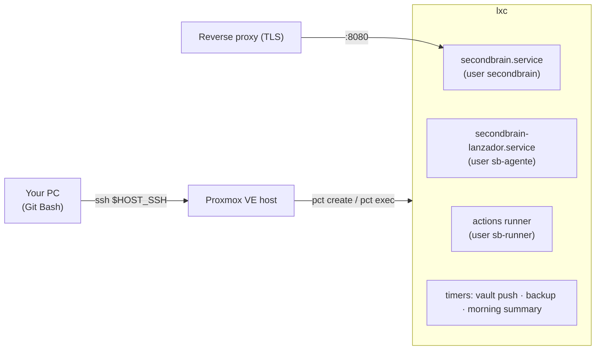

# Deployment

SecondBrain runs on one machine you control. There are two supported paths:

| Path                                                       | Use it for                                           | Agents (`launcher`) |
| ---------------------------------------------------------- | ---------------------------------------------------- | ------------------- |
| [Docker Compose](#docker-compose)                          | Trying the app, a NAS, a small VPS                   | Not included        |
| [Proxmox VE container](#proxmox-ve-container-full-install) | The full system with isolated agents, CD and backups | Included            |

The app never needs inbound ports other than HTTPS through your reverse proxy.
Configuration is in [configuration](configuration.md); day-two tasks
(backups, rollback, rebuild) are in [operations](operations.md).

## Docker Compose

```sh
mkdir -p ~/sb-vault                       # an empty folder or an existing vault
cd dashboard
VAULT_ROOT=~/sb-vault docker compose up -d --build
```

The API and the dashboard are served on `127.0.0.1:8080`. Put a TLS reverse
proxy in front of it and set `TRUSTED_PROXY` to the proxy's address so client
IPs and secure cookies work. The first visit creates the owner account.

`DATA_DIR` (default `./.data`) holds authentication, journal and history; back
it up together with the vault.

## Proxmox VE container (full install)

`ops/lxc` builds a Debian container with everything: the service, the agent
runner under its own user, nftables rules, systemd units, timers and the
GitHub Actions runner for deployment.



### Requirements

- A Proxmox VE host reachable with key-based SSH (an alias in `~/.ssh/config`).
- Git Bash (or any POSIX shell), Node.js 24 and an authenticated `gh` on your PC.
- A reverse proxy with TLS that forwards `/`, `/api/`, `/mcp`, `/oauth/*` and
  `/.well-known/oauth-*` to `http://<container-ip>:8080`, with a request body
  limit above 100 MB (the briefcase upload limit).

### Install

```sh
cp ops/lxc/lxc.env.example ops/lxc/lxc.env   # git-ignored; fill in your values
npm run setup
bash ops/lxc/instalar.sh                      # build, create, provision, verify
```

`instalar.sh` never destroys an existing container. `--reusar` provisions an
existing one; do not use it as a routine deployment.

Then, inside the container, connect the provider accounts interactively
(they are never copied from your PC or passed through chat):

```sh
ssh -t <host> pct enter <vmid>
bash /root/sb-lxc/dentro/conectar.sh
bash /root/sb-lxc/dentro/verificar.sh
```

### Rehearsal first

Use a copy of `lxc.env` with a free VMID and IP. Leaving `REPO_VAULT` empty
creates a small synthetic vault, `RUNNER_NOMBRE` empty skips the deployment
runner and `HEALTH_PUBLICO` empty skips the public health check.

### Continuous deployment

After the runner is registered, deployments come from version tags through
`deploy.yml` with a manual approval — see [CI/CD](ci-cd.md). In GitHub, create
the `production` environment with:

| Setting                      | Value                            |
| ---------------------------- | -------------------------------- |
| Required reviewers           | You                              |
| Deployment branches and tags | Tags matching `v*`               |
| Variable `SB_DEPLOY_OWNER`   | Your GitHub user or organization |
| Variable `SB_PUBLIC_URL`     | `https://your-domain` (optional) |

The runner's label must match the one in `deploy.yml`
(`secondbrain-production`) and `RUNNER_ETIQUETA` in `lxc.env`.

### One-time upgrade to the container release

Releases from Phase 1.5 run the service in Podman and need a new deploy
helper. The helper installed on an older host rejects the new package, and
nothing activates. Before you approve the first such tag, run these steps as
root in the LXC. `aprovisionar.sh` already does this on a new host.

1. Install Podman: `apt-get install -y podman`.
2. Record the image repository in lowercase:
   `printf 'ghcr.io/<owner>/<repo>\n' > /etc/secondbrain/image-repository`.
3. The first push creates the GHCR package as **private**. Make it public in
   the package settings, or write a read-only `podman login` auth file to
   `/etc/secondbrain/registry-auth.json` (mode `0600`).
4. Download the release artifact and install the new helper from it:
   `install -m 0755 ops/deploy/deploy-release.sh /usr/local/sbin/secondbrain-deploy`.
5. Approve the deployment. Afterwards, `bash /opt/secondbrain/current/ops/deploy/verify.sh /opt/secondbrain/current`
   must pass. The native `secondbrain.service` stays disabled, and a rollback to
   a release without `image-reference` turns it back on.

The host layout keeps its Spanish names until you run the separate
[host layout migration](host-layout-migration.md).

### Production layout

| Path                                         | Content                                        |
| -------------------------------------------- | ---------------------------------------------- |
| `/opt/secondbrain/releases/<sha>`, `current` | Launcher, MCP and operations code              |
| `secondbrain-container.service` (Quadlet)    | Service, MCP and dashboard image, by digest    |
| `/srv/secondbrain/vault`                     | Vault (own Git repository)                     |
| `/var/lib/secondbrain`                       | `DATA_DIR`: auth, journal, history, briefcase  |
| `/var/lib/sb-agente`                         | Agent sessions, conversations, provider logins |
| `/etc/secondbrain/*.env`                     | Host-only settings (backup, alerts, deploy)    |
| `/opt/actions-runner`                        | Deployment runner (user `sb-runner`)           |

A release package contains code only: no vault, credentials or state.
